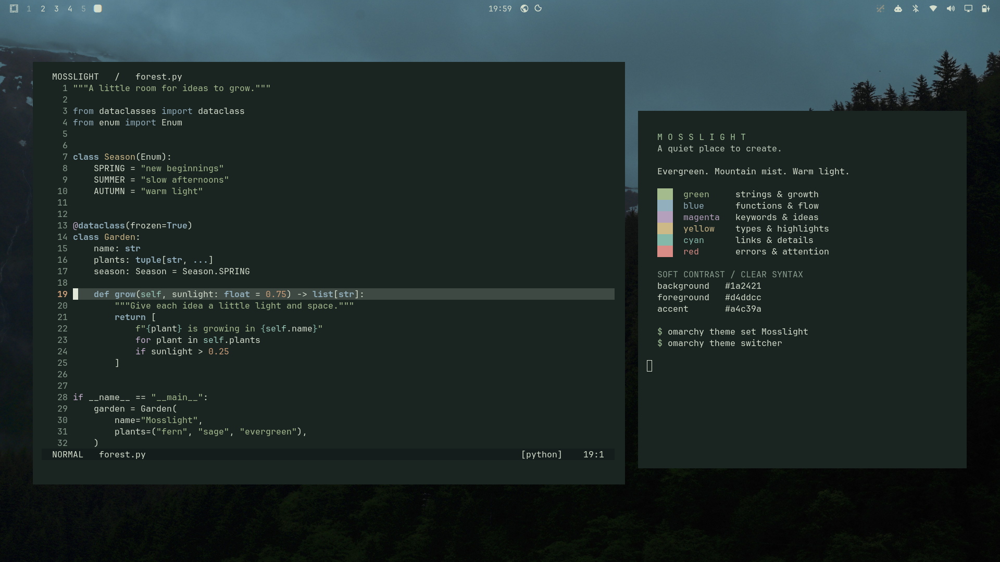
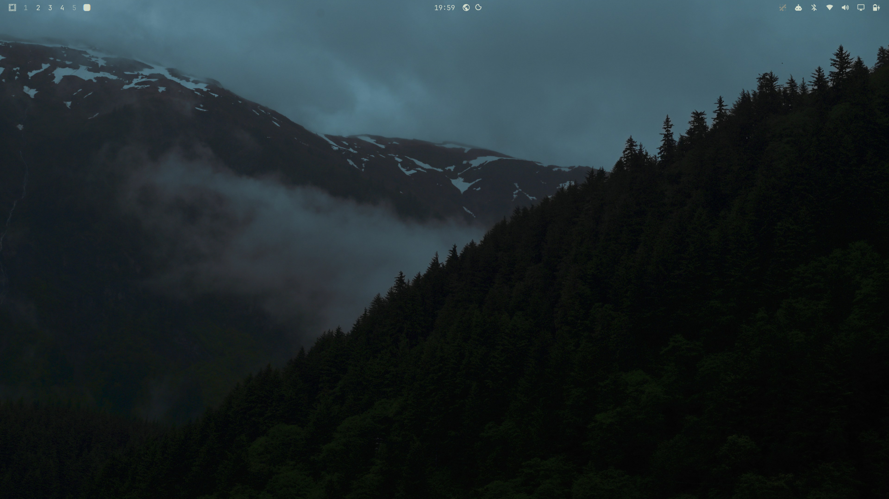
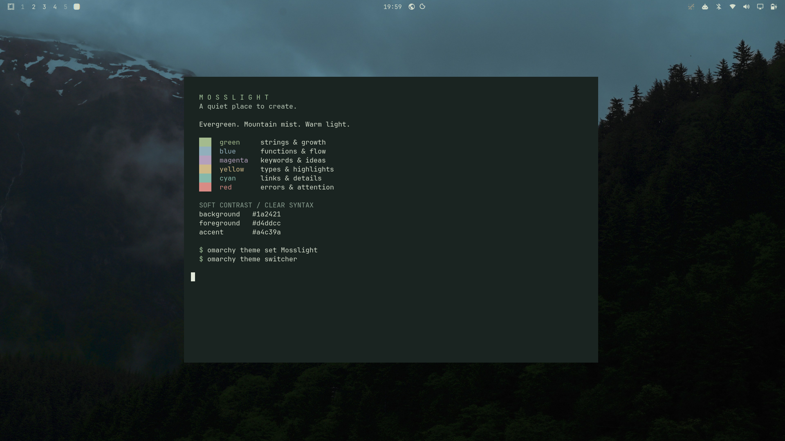
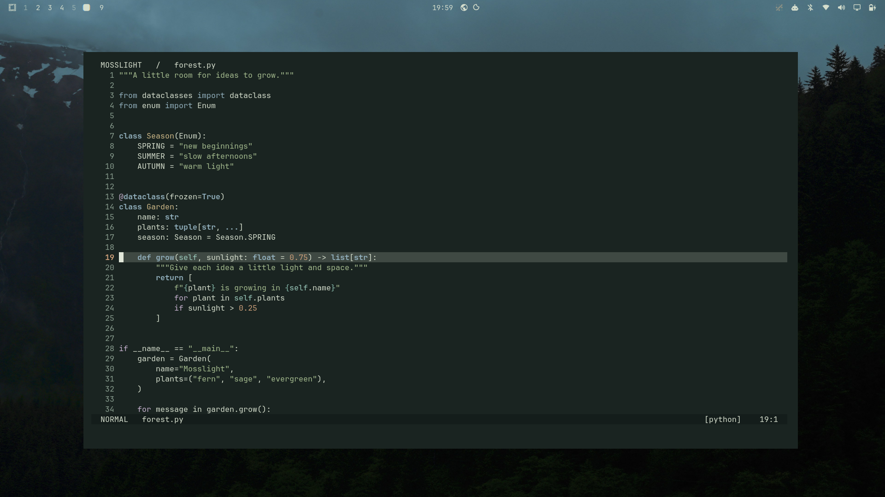

# Mosslight

A dark Omarchy theme inspired by moss, evergreen forests, and mountain mist.
Made for creative coding: green-charcoal surfaces, warm pale text, sage
strings, mist-blue functions, lilac keywords, amber highlights, and soft coral
errors.



## Screenshots

Captured on a real Omarchy desktop at 1920 × 1080. The coding preview uses
Foot and Neovim with Omarchy's generated Aether colors and a small sample
Python file. Window placement and editor layout are arranged for the preview;
the theme itself supplies colors and wallpaper.

<table>
  <tr>
    <td width="50%">
      <a href="screenshots/desktop.png"></a>
      <p align="center"><strong>Desktop</strong> · forest wallpaper and shell</p>
    </td>
    <td width="50%">
      <a href="screenshots/terminal.png"></a>
      <p align="center"><strong>Terminal</strong> · palette and readable contrast</p>
    </td>
  </tr>
  <tr>
    <td width="50%">
      <a href="screenshots/editor.png"></a>
      <p align="center"><strong>Editor</strong> · Python syntax in Neovim</p>
    </td>
    <td width="50%">
      <a href="preview.png"></a>
      <p align="center"><strong>Coding workspace</strong> · the complete look</p>
    </td>
  </tr>
</table>

## Install

```sh
omarchy theme install https://github.com/rupak-at/omarchy-mosslight-theme.git
```

Switch back to Mosslight at any time:

```sh
omarchy theme set Mosslight
```

Use `omarchy theme switcher` to choose another installed theme.

To select the bundled wallpaper directly:

```sh
omarchy theme bg set ~/.config/omarchy/themes/mosslight/backgrounds/01-evergreen-mist.jpg
```

## Compatibility

Built and verified on Omarchy 4.5.0-3. This theme uses `colors.toml` and
Omarchy's installed templates to style supported terminals, Neovim, Helix,
VS Code, btop, the shell, and other supported apps. No install script or
third-party editor theme extension is required by this repository.

`icons.theme` selects Omarchy's Yaru-sage icons.
Fonts, window geometry, and desktop layout follow your existing settings.

## Palette

| Role | Color |
| --- | --- |
| Background | `#1a2421` |
| Foreground | `#d4ddcc` |
| Accent | `#a4c39a` |
| Green | `#a4bb8e` |
| Cyan | `#86b8aa` |
| Blue | `#91afbc` |
| Magenta | `#b4a0bd` |
| Yellow | `#cdb887` |
| Red | `#d98b85` |

Foreground/background contrast is approximately 11.4:1. Base syntax colors
and comment colors exceed 5:1 against the background. Comfort and perceived
contrast also depend on your display, environment, and application settings.

## Credits and license

Theme configuration and project documentation: MIT; see [LICENSE](LICENSE).
Screenshots show the bundled wallpaper, which retains the license below.

Wallpaper: [Misty mountains covered in dark evergreen trees](https://unsplash.com/photos/Sv67jNNMpo0)
by Kyle Larivee, distributed under the [Unsplash License](https://unsplash.com/license).
The wallpaper remains under its original license and is not covered by this
repository's MIT license.
